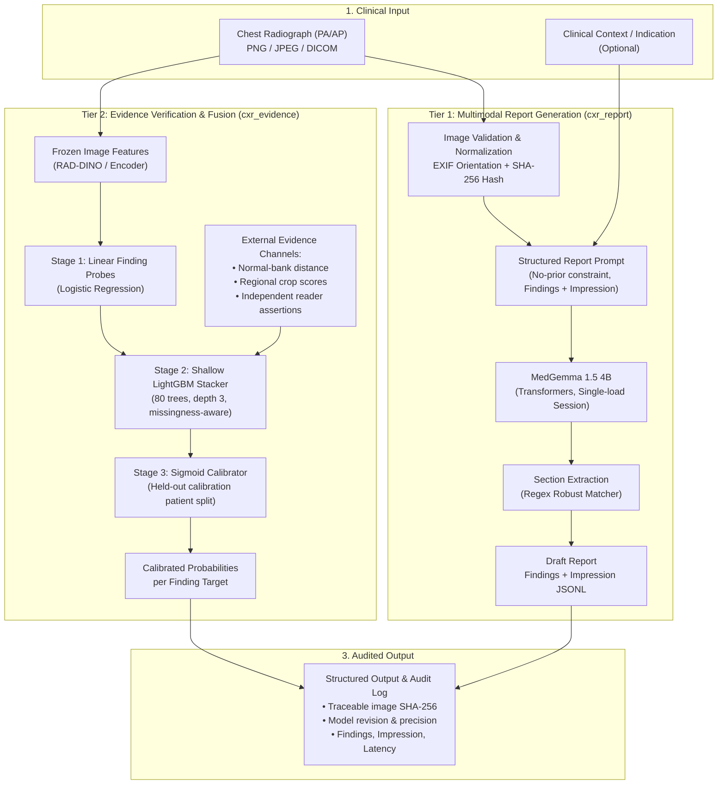

<a name="top"></a>

# SeeSay: Evidence-Checked Chest X-Ray Report Generation

[](https://www.python.org/)
[](https://pytorch.org/)
[](https://huggingface.co/docs/transformers)
[](https://lightgbm.readthedocs.io/)
[](https://openi.nlm.nih.gov/)
[](#-testing--quality-assurance)
[](LICENSE)
[](#-hardware-profile)

⭐ **SeeSay** shifts Radiology Report Generation (RRG) from pure autoregressive language generation to an **evidence-checked decision framework**, addressing the two most severe clinical failure modes in medical vision-language models: **invented abnormalities on normal studies (hallucinations)** and **omitted critical findings**.

---

## Table of Contents
- [Executive Overview](#-executive-overview)
- [System Architecture](#-system-architecture)
- [Repository Structure](#-repository-structure)
- [Quickstart: Local Installation](#-quickstart-local-installation)
- [Quickstart: Kaggle GPU Inference](#-quickstart-kaggle-gpu-inference)
- [Evidence Stacking Engine (`cxr_evidence`)](#-evidence-stacking-engine-cxr_evidence)
- [Data Contract & Integrity](#-data-contract--integrity)
- [Testing & Quality Assurance](#-testing--quality-assurance)
- [Benchmark Targets & Methodology](#-benchmark-targets--methodology)
- [Project Roadmap](#-project-roadmap)
- [License & Clinical Disclaimer](#-license--clinical-disclaimer)

---

## 🚀 Executive Overview

Current Vision-Language Models (VLMs) trained on chest radiographs frequently optimize for text-similarity heuristics (BLEU, CIDEr) rather than clinical accuracy. This produces two major clinical hazards:
1. **The Normal-Study Penalty**: A single hallucinated finding on a healthy patient severely degrades clinical utility (penalized heavily by metrics like CRIMSON and GREEN).
2. **The "Knowing–Saying" Gap**: Models often detect subtle radiological signals in their visual latent embeddings, but shared language priors cause the decoder to revert to generic, safe boilerplate.

**SeeSay** solves this with a decoupled two-tier architecture:
- **Tier 1 (Clinical Generator)**: Standalone multimodal VLM ([`google/medgemma-1.5-4b-it`](https://huggingface.co/google/medgemma-1.5-4b-it)) generating structured `Findings:` and `Impression:` sections with strict single-study prompt constraints.
- **Tier 2 (Evidence & Calibration Engine)**: A lightweight machine learning stack (finding-level probes $\to$ multi-channel LightGBM fusion $\to$ held-out sigmoid calibration) that evaluates claim certainty and enforces patient-grouped cross-validation.

---

## 🏗️ System Architecture



---

## 📁 Repository Structure

```
radiology/
├── src/
│   ├── cxr_report/            # Tier 1: MedGemma generation pipeline
│   │   ├── images.py          # Pillow loading, EXIF orientation, SHA-256
│   │   ├── prompts.py         # Versioned prompt configs (Findings/Impression)
│   │   ├── model.py           # MedGemma single-process loader (FP16 / 4-bit)
│   │   ├── generator.py       # Chat template, inference mode, truncation detection
│   │   ├── output.py          # Section parser, atomic JSONL serialization
│   │   ├── batch.py           # Resumable batch runner with error logging
│   │   └── cli.py             # CLI: generate, batch, info
│   └── cxr_evidence/          # Tier 2: Evidence stacking & calibration engine
│       ├── data.py            # Strict pickle-free .npz data contract
│       ├── training.py        # Grouped cross-validation, LightGBM, calibration
│       ├── demo.py            # Synthetic 240-study plumbing fixture
│       └── cli.py             # CLI: train, demo, predict
├── notebooks/
│   └── medgemma_report_generation.py # Production Kaggle GPU script
├── examples/
│   └── manifest.jsonl         # Example batch input manifest
├── tests/
│   ├── test_report_pipeline.py# Unit & mock tests for cxr_report (18 tests)
│   └── test_training.py       # Validation, leakage, round-trip tests (8 tests)
├── docs/
│   ├── implementation-plan.md # 8-stage engineering specification
│   └── report-generation-mvp.md # MedGemma generator milestone spec
├── pyproject.toml             # Setuptools build definition with [generation] extra
└── README.md
```

---

## ⚡ Quickstart: Local Installation

### Prerequisites
- Python 3.11+
- Git

```bash
# Clone the repository
git clone https://github.com/ParasKaushal123/SeeSay.git
cd SeeSay

# Create and activate virtual environment
python -m venv .venv
source .venv/bin/activate       # Linux/macOS
# .\.venv\Scripts\Activate.ps1   # Windows PowerShell

# Install package and test dependencies
pip install -e ".[dev]"
```

### Run the Synthetic Evidence Pipeline (CPU Demo)
```bash
python -m cxr_evidence demo --output artifacts/demo
```
This fits finding probes, trains the LightGBM stacker, and runs held-out sigmoid calibration on a 240-study synthetic fixture in **under 1 second**.

---

## 🌐 Quickstart: Kaggle GPU Inference

For generating reports with MedGemma on a free Kaggle GPU (T4 / P100):

### 1. Attach Dataset & Enable Internet
- Attach the **[`raddar/chest-xrays-indiana-university`](https://www.kaggle.com/datasets/raddar/chest-xrays-indiana-university)** dataset.
- In Kaggle sidebar: set **Internet $\to$ On** and **Accelerator $\to$ GPU T4 x2**.

### 2. Setup & Import (Cell 1)
```python
# Clone repo & install
!rm -rf /kaggle/working/radiology
!git clone https://github.com/ParasKaushal123/SeeSay.git /kaggle/working/radiology
!pip install -q -e "/kaggle/working/radiology[generation]"

# Inject src to path and import
import sys
sys.path.insert(0, "/kaggle/working/radiology/src")

from cxr_report.model import ModelInfo, load_medgemma
from cxr_report.generator import generate_report
from cxr_report.batch import run_batch, load_manifest
```

### 3. Load or Reuse Model (Cell 2)
```python
# Reuses existing in-memory weights if previously loaded
if 'model' in globals() and 'processor' in globals():
    model_info = ModelInfo("google/medgemma-1.5-4b-it", getattr(model.config, "_commit_hash", None),
                           str(next(model.parameters()).dtype), "auto", False)
else:
    model, processor, model_info = load_medgemma("google/medgemma-1.5-4b-it", device_map="auto")
```

### 4. Resumable Batch Run (Cell 3)
```python
from pathlib import Path
manifest = load_manifest("/kaggle/working/radiology/examples/manifest.jsonl")

stats = run_batch(
    model=model,
    processor=processor,
    model_info=model_info,
    manifest=manifest,
    output_path=Path("/kaggle/working/reports/iu_reports.jsonl"),
    resume=True,
    max_new_tokens=384,
)
print("Batch complete:", stats)
```

---

## 🔬 Evidence Stacking Engine (`cxr_evidence`)

The evidence stacking pipeline trains without GPU requirements from pre-extracted `.npz` feature archives:

1. **Patient-Grouped Out-of-Fold Probes**: Standardized linear probes fit on image embeddings using `GroupKFold`, ensuring no patient crosses folds.
2. **Multi-Channel LightGBM Stacker**: Merges probe probabilities, external evidence channels (distance to healthy references, regional crop activations, second reader consensus), explicit missingness flags, and finding IDs.
3. **Held-Out Sigmoid Calibration**: A disjoint calibration patient split tunes the temperature of output margins to produce reliable confidence scores.

```bash
# Train on cached features
python -m cxr_evidence train --data datasets/iu_features.npz --output artifacts/run_v1

# Predict calibrated probabilities on unlabelled inference studies
python -m cxr_evidence predict --data datasets/iu_inference.npz --model artifacts/run_v1/model.joblib --output artifacts/preds.npz
```

---

## 🔒 Data Contract & Integrity

The evidence engine enforces a strict, pickle-free `.npz` data schema (`load_dataset`) with zero tolerance for silent leakage:

| Array Key | Shape | Type | Description |
|---|---|---|---|
| `study_ids` | `[N]` | String | Unique study identifiers (multi-view aggregated) |
| `patient_ids` | `[N]` | String | Enforces strict zero patient overlap across splits |
| `splits` | `[N]` | String | Partition labels: `train`, `calibration`, `validation`, `test` |
| `image_features` | `[N, D]` | Float32 | Finite frozen encoder representations |
| `evidence` | `[N, C, E]` | Float32 | Multi-channel features (`healthy__*`, `regional__*`, `reader__*`); NaN allowed for missing |
| `labels` | `[N, C]` | Int8 | Multi-label ground truth: `1` (positive), `0` (negative), `-1` (unmentioned/uncertain) |
| `label_source` | Scalar | String | Explicit provenance: `report_derived`, `image_adjudicated`, or `synthetic` |

---

## 🧪 Testing & Quality Assurance

Comprehensive automated test suite executed via `pytest`:

```powershell
pytest -v
```

```text
============================= test session starts =============================
platform win32 -- Python 3.11.9, pytest-9.1.1
rootdir: D:\projects\radiology
configfile: pyproject.toml
collected 26 items

tests\test_report_pipeline.py ..................                         [ 69%]
tests\test_training.py ........                                          [100%]

============================= 26 passed in 11.50s =============================
```

### Coverage Highlights:
- **Leakage Prevention**: Asserts ValueError is raised if a patient identifier appears in multiple splits.
- **Data Integrity**: Validates shapes, rejects non-finite features, empty arrays, or duplicate studies.
- **Section Parsing**: Handles `Findings:`, `FINDINGS:`, `Impression:`, missing sections, and malformed spacing.
- **Resume Idempotency**: Asserts batch processor skips completed studies without re-running model generation.
- **Mocked CI**: Image generation tested with mocked tensors; no GPU required for test runner.

---

## 🎯 Benchmark Targets & Methodology

The project targets official benchmarks on the **[ReXrank Leaderboard](https://rexrank.ai/)**:

- **Target Dataset**: IU X-Ray (Official 296 validation / 590 test split)
- **Primary Metrics**:
  - **GREEN**: Evaluator measuring clinical correctness via language model error category alignment.
  - **CRIMSON**: Asymmetric clinical risk score heavily penalizing false positives on normal studies.
  - **RadGraph**: Micro-averaged factual F1 on clinical entities and relations.
- **Reference Baselines**:
  - UniRG-CXR Published Baseline: **0.469 GREEN** (ReXGradient Private Test) / **0.664 GREEN** (IU Findings).

> *Note: Published scores are external baselines from Microsoft Research and Rajpurkar Lab; local measurements will be logged as evaluated.*

---

## 🗺️ Project Roadmap

- [x] **Milestone 1**: Lightweight evidence stacking pipeline (`cxr_evidence`) with patient-grouped folds, LightGBM, and calibration.
- [x] **Milestone 2**: MedGemma reporting pipeline (`cxr_report`) with single-image generation, section extraction, and resumable batch processing.
- [x] **Milestone 3**: Successful 50-study smoke batch on real IU X-ray radiographs in Kaggle GPU environment.
- [ ] **Milestone 4**: Automated extraction of frozen image embeddings (RAD-DINO / MedGemma vision encoder) across the official 590 IU test studies.
- [ ] **Milestone 5**: Rule-based and calibrated text edit policy (`reports/editor.py`) to prune hallucinated assertions on high-confidence normal studies.
- [ ] **Milestone 6**: Official GREEN and CRIMSON paired evaluation against unedited MedGemma baselines.

---

## 📄 License & Clinical Disclaimer

This repository is distributed under the [MIT License](LICENSE).

> ⚠️ **CLINICAL NOTICE**: This software is an academic research prototype and is **NOT** a certified medical device. It is not approved by the FDA, EMA, or any regulatory authority for diagnostic or clinical decision-making. Outputs must not be used for patient care without licensed physician evaluation.

[Back to top](#top)
